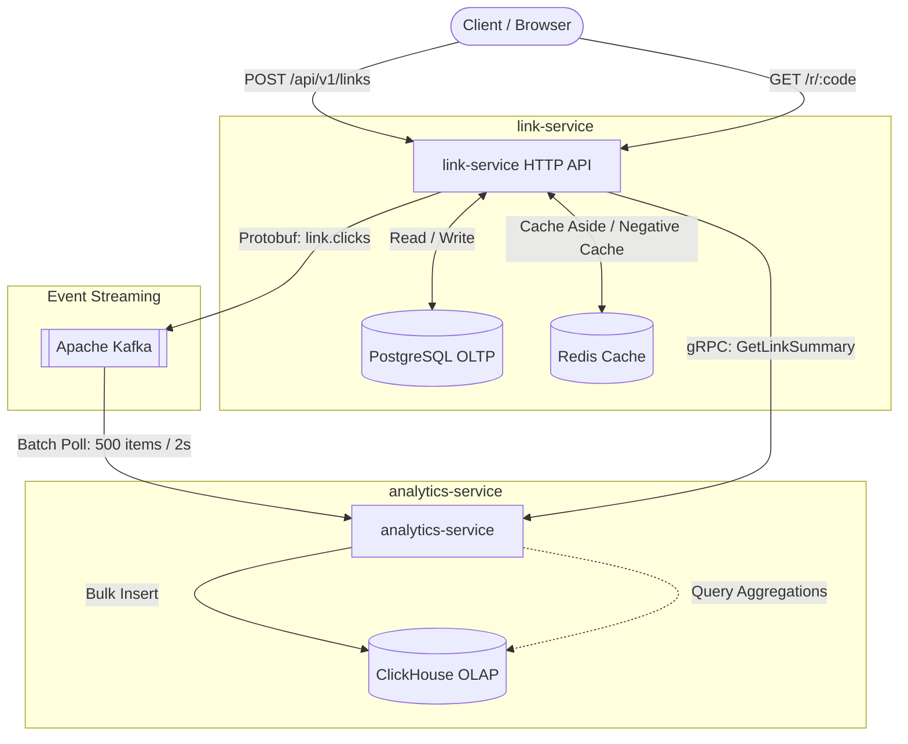

# Giga URL Shortener

Распределенный сервис сокращения ссылок со сбором аналитики переходов в реальном времени.

Проект спроектирован для практической отработки паттернов распределенных систем, очередей сообщений и колоночных баз данных.



## Сервисы и компоненты

- `link-service`: REST API на Chi. Создает короткие ссылки, сохраняет их в PostgreSQL, кэширует в Redis. Отдает HTTP 302 редирект и отправляет события кликов в Kafka. По запросу ходит в `analytics-service` по gRPC за статистикой.
- `analytics-service`: фоновый консьюмер на `franz-go` и gRPC сервер. Вычитывает события из Kafka, обогащает их метаданными (браузер, ОС, тип устройства) и пачками пишет в ClickHouse. Отдает агрегированную аналитику по gRPC.

## Инженерные решения

### Защита от Cache Penetration (Negative Caching)
Если запрошен несуществующий короткий код, сервис проверяет Redis, затем идет в PostgreSQL. При отсутствии записи в базе в Redis сохраняется пустая строка с коротким TTL (30 секунд). Повторные запросы по несуществующему коду отсекаются на уровне Redis и не нагружают PostgreSQL.

### Батчинг в ClickHouse
ClickHouse спроектирован для аналитики и плохо справляется с частыми одиночными вставками. Сервис аналитики накапливает события в памяти и сбрасывает их в ClickHouse пачками. Сброс происходит при накоплении 500 записей или по таймеру каждые 2 секунды.

### Семантика At-Least-Once
Оффсеты сообщений в Kafka коммитятся строго после успешного выполнения пакетной вставки в ClickHouse. Если запись в базу завершилась ошибкой, оффсеты не фиксируются. Это гарантирует сохранность данных при сбоях. Возможные редкие дубликаты не влияют на точность метрик благодаря расчету уникальных пользователей через `uniqExact(ip)`.

### Обогащение данных вне горячего пути
Парсинг строки User-Agent вынесен из сервиса редиректов в сервис аналитики. Это сохраняет минимальную задержку на основном пути перехода по ссылке. Консьюмер аналитики разбирает заголовок и нормализует браузер, ОС и категорию устройства перед сохранением.

### Межсервисный gRPC
Сервисы взаимодействуют по контракту Protocol Buffers v3. Получение сводки по ссылке выполняется через метод `GetLinkSummary`.

## Локальный запуск

Для работы требуется Docker и Docker Compose.

Запуск всех компонентов и сервисов:
```bash
make start
```
Команда собирает образы приложений, накатывает миграции PostgreSQL через Goose, инициализирует структуру таблиц в ClickHouse и запускает контейнеры.

Остановка окружения:
```bash
make stop
```

Остановка с удалением всех данных в томах:
```bash
make clean
```

## Примеры использования

### Сквозной сценарий проверки (Bash)

Скрипт создает ссылку, извлекает динамический короткий код в переменную, выполняет переходы с разными User-Agent и запрашивает агрегированную статистику:

```bash
# Создание ссылки и сохранение сгенерированного кода
CODE=$(curl -s -X POST http://localhost:8080/api/v1/links \
  -H "Content-Type: application/json" \
  -d '{"original_url": "https://go.dev"}' | grep -o '"short_code":"[^"]*' | cut -d'"' -f4)

echo "Создан код: $CODE"

# Переход по ссылке (HTTP 302)
curl -i "http://localhost:8080/r/$CODE"

# Переход с эмуляцией мобильного устройства
curl -i -A "Mozilla/5.0 (iPhone; CPU iPhone OS 17_0 like Mac OS X)" "http://localhost:8080/r/$CODE"

# Ожидание сброса буфера в ClickHouse (таймаут батчинга 2 секунды)
sleep 2

# Получение аналитики по ссылке
curl "http://localhost:8080/r/$CODE/stats"
```

Пример ответа аналитики:
```json
{
  "short_code": "SQw1LTX",
  "total_clicks": 2,
  "unique_clicks": 1,
  "browsers": {
    "curl": 1,
    "iPhone": 1
  },
  "os": {
    "Unknown": 1,
    "iOS": 1
  },
  "devices": {
    "Mobile": 1,
    "Unknown": 1
  }
}
```

### Пошаговые запросы вручную

Создание ссылки:
```bash
curl -X POST http://localhost:8080/api/v1/links \
  -H "Content-Type: application/json" \
  -d '{"original_url": "https://go.dev"}'
```

Вместо `:code` подставьте значение поля `short_code` из ответа:
```bash
curl -i http://localhost:8080/r/:code
curl http://localhost:8080/r/:code/stats
```

## Порты и окружение

- `8080`: HTTP API `link-service`
- `8082`: HTTP healthcheck `analytics-service`
- `50051`: gRPC `analytics-service`
- `5432`: PostgreSQL
- `6379`: Redis
- `8123`: ClickHouse HTTP
- `9000`: ClickHouse Native TCP
- `9092`: Kafka внешний доступ
- `8085`: Kafka UI

## Планы развития

- Сквозной трейсинг (OpenTelemetry, Jaeger) через HTTP, базы данных, брокер сообщений и gRPC.
- Метрики сервисов и очередей (Prometheus, Grafana).
- Асинхронная неблокирующая отправка кликов в Kafka на горячем пути редиректа.