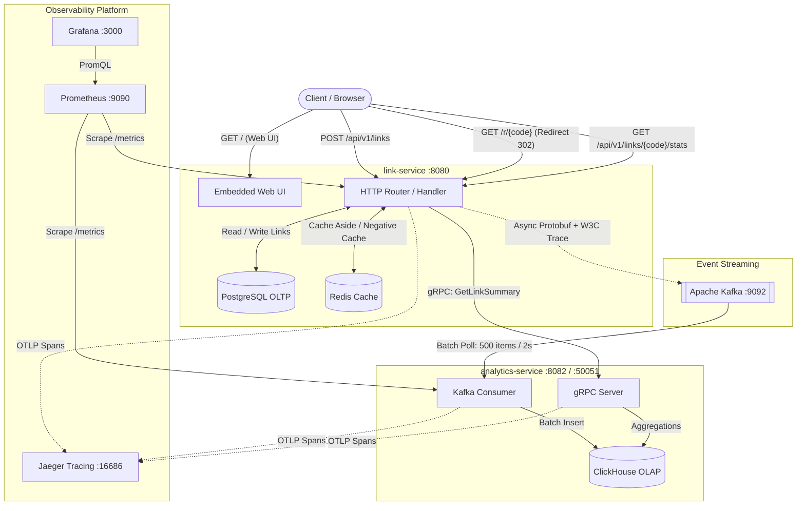

# Giga URL Shortener

Распределенный сервис сокращения ссылок со сбором аналитики переходов в реальном времени.

Проект спроектирован для практической отработки паттернов распределенных систем, очередей сообщений, колоночных баз данных и сквозной наблюдаемости (Observability).



## Сервисы и компоненты

- `link-service`: REST API на базе Chi и встроенный Web UI (`GET /`). Создает короткие ссылки, сохраняет их в PostgreSQL, кэширует в Redis. Отдает HTTP 302 редирект и неблокирующе отправляет события кликов в Kafka. По запросу клиента обращается к `analytics-service` по gRPC за агрегированной статистикой.
- `analytics-service`: фоновый консьюмер на `franz-go` и gRPC сервер. Вычитывает клики из топика Kafka, обогащает их метаданными (браузер, ОС, тип устройства) и сбрасывает пачками в ClickHouse. Отдает сводную аналитику по gRPC.
- `Observability стек`: OpenTelemetry (W3C трассировка) $\rightarrow$ Jaeger, Prometheus (сбор RED-метрик и батчинга) $\rightarrow$ Grafana.

## Инженерные решения

### Защита от Cache Penetration (Negative Caching)
Если запрошен несуществующий короткий код, сервис проверяет Redis, затем идет в PostgreSQL. При отсутствии записи в базе в Redis сохраняется пустая заглушка с коротким TTL (30 секунд). Повторные запросы по несуществующему коду отсекаются на уровне Redis и не нагружают PostgreSQL.

### Асинхронный продюсер Kafka на горячем пути редиректа
При переходе по ссылке задержка критична. Сервис не ожидает подтверждения отправки от брокера сообщений. Использован асинхронный метод `p.client.Produce(context.WithoutCancel(ctx), ...)` библиотеки `franz-go`:
- Событие помещается во внутренний буфер клиента и уходит в брокер в фоне.
- `context.WithoutCancel(ctx)` отвязывает асинхронную отправку от отмены HTTP-контекста после отправки 302-редиректа, но сохраняет Trace ID для распределенной трассировки.

### Батчинг в ClickHouse
ClickHouse спроектирован для аналитики и плохо справляется с частыми одиночными вставками. Сервис аналитики накапливает события в памяти и сбрасывает их в ClickHouse пачками. Сброс происходит при накоплении 500 записей или по таймеру каждые 2 секунды (`CLICKHOUSE_FLUSH_INTERVAL=2s`).

### Семантика At-Least-Once
Оффсеты сообщений в Kafka коммитятся строго после успешного выполнения пакетной вставки в ClickHouse (`CommitRecords` после `InsertBatch`). Если запись в базу завершилась ошибкой, оффсеты не фиксируются. Это гарантирует сохранность данных при сбоях. Возможные редкие дубликаты не влияют на точность метрик благодаря расчету уникальных пользователей через `uniqExact(ip)`.

### Обогащение данных вне горячего пути
Парсинг строки User-Agent вынесен из сервиса редиректов в сервис аналитики. Это сохраняет минимальную задержку на основном пути перехода по ссылке. Консьюмер аналитики разбирает заголовок и нормализует браузер, ОС и категорию устройства перед сохранением.

### Межсервисный gRPC с авто-трассировкой
Сервисы взаимодействуют по контракту Protocol Buffers v3. В клиенте и сервере gRPC подключен `otelgrpc.StatsHandler`, который автоматически упаковывает и извлекает W3C Trace Context через gRPC Metadata без ручных интерцепторов.

### Сквозная распределенная трассировка (OpenTelemetry + Jaeger)
Сквозной Trace ID отслеживает весь жизненный цикл запроса через гетерогенные протоколы:
- `HTTP GET /r/{code}` (link-service)
- `redis.Get` (link-service)
- Инъекция W3C `traceparent` в Kafka Record Header
- Извлечение контекста в Kafka Consumer (analytics-service)
- `clickhouse.InsertBatch` (analytics-service)
- gRPC `AnalyticsService/GetLinkSummary` $\rightarrow$ `clickhouse.GetStats`

### Метрики Prometheus без High Cardinality
На эндпоинтах `/metrics` собираются метрики задержки (Histogram), количества запросов (Counter), скорости вычитки кликов из Kafka и размеров батчей ClickHouse. Для путей роутера используется Chi `chi.RoutePattern()` (`/r/{short_code}`), что защищает базу Prometheus от взрыва комбинаций лейблов при миллионах уникальных ссылок.

---

## Локальный запуск

Для работы требуется Docker и Docker Compose.

Запуск всех компонентов и сервисов:
```bash
make start
```
Команда собирает образы приложений, накатывает миграции PostgreSQL через Goose, инициализирует структуру таблиц в ClickHouse и запускает контейнеры.

Сборка с перекомпиляцией сервисов:
```bash
make build
```

Остановка окружения:
```bash
make stop
```

Остановка с удалением всех данных в томах:
```bash
make clean
```

---

## Веб-интерфейс

В `link-service` встроен легковесный веб-интерфейс разработчика:
- URL: **[http://localhost:8080](http://localhost:8080)**
- Позволяет сокращать ссылки, копировать результат и в реальном времени запрашивать аналитику по коду с раскладкой по браузерам, ОС и типам устройств.

---

## Примеры использования API

### Сквозной сценарий проверки (Bash / Linux / macOS)

Скрипт создает ссылку, извлекает динамический короткий код в переменную, выполняет переходы с разными User-Agent, выжидает сброс буфера в ClickHouse и запрашивает агрегированную статистику:

```bash
# Создание ссылки и сохранение сгенерированного кода
CODE=$(curl -s -X POST http://localhost:8080/api/v1/links \
  -H "Content-Type: application/json" \
  -d '{"original_url": "https://go.dev"}' | grep -o '"short_code":"[^"]*' | cut -d'"' -f4)

echo "Создан код ссылки: $CODE"

# Переход по ссылке (HTTP 302 Found)
curl -i "http://localhost:8080/r/$CODE"

# Переход с эмуляцией мобильного устройства
curl -i -A "Mozilla/5.0 (iPhone; CPU iPhone OS 17_0 like Mac OS X)" "http://localhost:8080/r/$CODE"

# Ожидание сброса буфера в ClickHouse (flush_interval = 2s)
sleep 2

# Получение аналитики по ссылке
curl -s "http://localhost:8080/api/v1/links/$CODE/stats"
```

### Сквозной сценарий проверки (PowerShell / Windows)

```powershell
# Создание ссылки
$resp = Invoke-RestMethod -Uri "http://localhost:8080/api/v1/links" -Method Post `
  -ContentType "application/json" -Body '{"original_url": "https://go.dev"}'
$code = $resp.short_code
Write-Host "Создан код ссылки: $code"

# Переход по ссылке (HTTP 302)
curl.exe -i "http://localhost:8080/r/$code"

# Переход с эмуляцией мобильного устройства
curl.exe -i -A "Mozilla/5.0 (iPhone; CPU iPhone OS 17_0 like Mac OS X)" "http://localhost:8080/r/$code"

# Ожидание сброса пачки в ClickHouse
Start-Sleep -Seconds 2

# Получение аналитики
Invoke-RestMethod -Uri "http://localhost:8080/api/v1/links/$code/stats" | ConvertTo-Json
```

Пример ответа аналитики:
```json
{
  "short_code": "0riJiVg",
  "total_clicks": 2,
  "unique_clicks": 1,
  "browsers": {
    "curl": 1,
    "iPhone": 1
  },
  "os": {
    "Unknown": 1,
    "iOS": 1
  },
  "devices": {
    "Mobile": 1,
    "Unknown": 1
  }
}
```

---

## Пошаговые запросы вручную

Создание ссылки:
```bash
curl -X POST http://localhost:8080/api/v1/links \
  -H "Content-Type: application/json" \
  -d '{"original_url": "https://go.dev"}'
```

Переход по ссылке (вместо `:code` подставьте сгенерированный код):
```bash
curl -i http://localhost:8080/r/:code
```

Запрос аналитики переходов:
```bash
curl http://localhost:8080/api/v1/links/:code/stats
```

---

## Порты и веб-интерфейсы

| Сервис / Порт | Назначение | Доступ |
| :--- | :--- | :--- |
| `8080` | **link-service** (Web UI + REST API) | [http://localhost:8080](http://localhost:8080) |
| `16686` | **Jaeger UI** (сквозной трейсинг) | [http://localhost:16686](http://localhost:16686) |
| `9090` | **Prometheus UI** (TSDB и PromQL) | [http://localhost:9090](http://localhost:9090) |
| `3000` | **Grafana UI** (дашборды метрик, `admin`/`admin`) | [http://localhost:3000](http://localhost:3000) |
| `8085` | **Kafka UI** (мониторинг топиков и консьюмер-групп) | [http://localhost:8085](http://localhost:8085) |
| `8082` | **analytics-service** (эндпоинты `/metrics` и `/healthz`) | [http://localhost:8082](http://localhost:8082) |
| `50051` | **analytics-service** (межсервисный gRPC) | Внутренняя сеть Docker |
| `5432` | **PostgreSQL** | `localhost:5432` |
| `6379` | **Redis** | `localhost:6379` |
| `8123` / `9000` | **ClickHouse** (HTTP / Native TCP) | `localhost:8123` / `localhost:9000` |
| `9092` | **Apache Kafka** | `localhost:9092` |

---

## Планы развития

- Rate Limiting (Token Bucket / Sliding Window) в Redis для защиты от флуда и DoS.
- Поддержка кастомных алиасов ссылок (custom short codes).
- Настраиваемый срок жизни ссылок (Link TTL) и фоновый воркер очистки устаревших записей.
- Автоматический provisioning дашбордов и алертов в Grafana через конфиг-файлы.