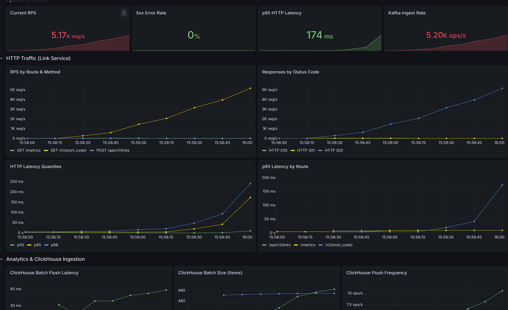
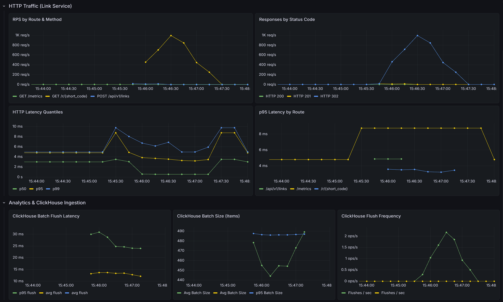
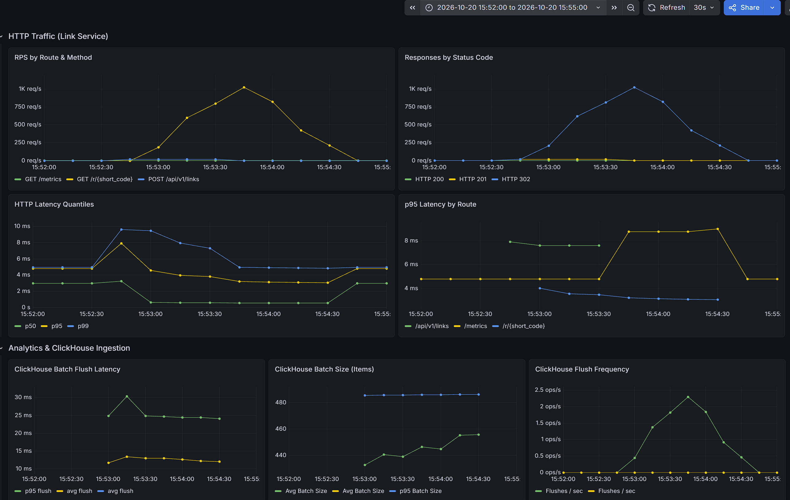
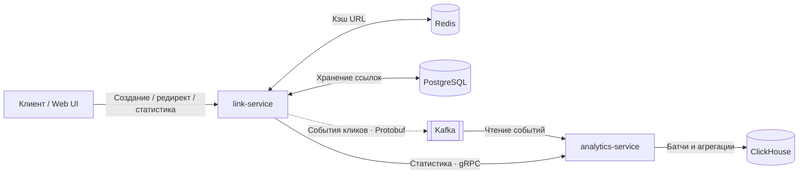

# Giga URL Shortener

Сервис коротких ссылок на Go с асинхронной аналитикой переходов.

Ссылки хранятся в PostgreSQL и кэшируются в Redis. События кликов передаются через Kafka в отдельный сервис, который разбирает User-Agent и записывает данные пачками в ClickHouse.

**Ключевые решения:**

- **Кэширование с обработкой ошибок:** cache-aside, обращение к PostgreSQL при ошибке чтения Redis и negative caching для повторных запросов отсутствующих кодов.
- **Аналитика вне обработки редиректа:** асинхронная публикация событий, разбор User-Agent в consumer и пакетная запись в ClickHouse.
- **Измеримость:** метрики HTTP и батчинга, передача trace context через Kafka и gRPC, сценарий нагрузки на k6.

**Стек:** Go, Chi, PostgreSQL, Redis, Kafka / franz-go, ClickHouse, gRPC / Protobuf, OpenTelemetry, Prometheus, Grafana, Docker Compose.

[Быстрый запуск](#быстрый-запуск) · [Нагрузка](#предварительные-нагрузочные-наблюдения) · [Архитектура](#архитектура) · [Решения и ограничения](#решения-и-ограничения) · [API](api/openapi.yaml)

## Быстрый запуск

Нужны Docker с поддержкой Linux-контейнеров и Docker Compose. Из корня репозитория:

```bash
docker compose -f deploy/docker-compose.yaml up -d --build
```

Команда собирает приложения, запускает зависимости и миграции PostgreSQL через Goose. При инициализации ClickHouse создаётся таблица аналитики. Первая сборка требует загрузки образов и Go-зависимостей.

После запуска откройте **[http://localhost:8080](http://localhost:8080)**:

1. Создайте короткую ссылку для `https://go.dev`.
2. Перейдите по полученной ссылке.
3. Через несколько секунд запросите статистику по её коду в UI.

Ожидаемый результат: редирект HTTP 302, затем появление клика в статистике. Обновление асинхронное: consumer сбрасывает накопленные события при 500 записях или по таймеру каждые 2 секунды. При отставании consumer или ошибках записи ожидание увеличивается.

<details>
<summary>Команды и примеры API</summary>

| Действие | Команда |
| --- | --- |
| Сборка и запуск | `docker compose -f deploy/docker-compose.yaml up -d --build` |
| Остановка с сохранением данных | `docker compose -f deploy/docker-compose.yaml stop` |
| Удаление контейнеров и данных | `docker compose -f deploy/docker-compose.yaml down -v` |
| Логи приложений | `docker compose -f deploy/docker-compose.yaml logs --tail=100 link-service analytics-service` |

При установленном Make доступны `make start`, `make build`, `make stop` и `make clean`.

### Bash / Linux / macOS

Для разбора JSON в этом примере дополнительно нужен `jq`.

```bash
CODE=$(curl -fsS -X POST http://localhost:8080/api/v1/links \
  -H "Content-Type: application/json" \
  -d '{"original_url":"https://go.dev"}' | jq -er '.short_code')

echo "Создан код: $CODE"

curl -i "http://localhost:8080/r/$CODE"
curl -i -A "Mozilla/5.0 (iPhone; CPU iPhone OS 17_0 like Mac OS X)" \
  "http://localhost:8080/r/$CODE"

sleep 3
curl -fsS "http://localhost:8080/api/v1/links/$CODE/stats" | jq
```

### PowerShell / Windows

```powershell
$resp = Invoke-RestMethod -Uri "http://localhost:8080/api/v1/links" -Method Post `
  -ContentType "application/json" -Body '{"original_url":"https://go.dev"}'
$code = $resp.short_code
Write-Host "Создан код: $code"

curl.exe -i "http://localhost:8080/r/$code"
curl.exe -i -A "Mozilla/5.0 (iPhone; CPU iPhone OS 17_0 like Mac OS X)" "http://localhost:8080/r/$code"

Start-Sleep -Seconds 3
Invoke-RestMethod -Uri "http://localhost:8080/api/v1/links/$code/stats" | ConvertTo-Json
```

Ожидаемые статусы: создание — `201`, редирект — `302` с заголовком `Location`, статистика — `200`. После обработки обоих событий `total_clicks` будет равен 2, если не было дополнительных переходов или повторной доставки. При одинаковом IP `unique_clicks` будет равен 1.

Пауза в примере даёт consumer время на обработку, но не гарантирует её завершение. Если события ещё не появились, повторите запрос статистики и проверьте логи `analytics-service`.

| Поле статистики | Значение |
| --- | --- |
| `short_code` | Код ссылки |
| `total_clicks` | Количество сохранённых событий, включая возможные дубликаты |
| `unique_clicks` | Количество уникальных IP-адресов |
| `browsers`, `os`, `devices` | Распределения событий по результату разбора User-Agent |

Полный контракт и примеры структуры ответа: [OpenAPI](api/openapi.yaml).

</details>

<details>
<summary>Интерфейсы и настройки</summary>

| Интерфейс | Адрес |
| --- | --- |
| Web UI и REST API | [localhost:8080](http://localhost:8080) |
| Jaeger | [localhost:16686](http://localhost:16686) |
| Prometheus | [localhost:9090](http://localhost:9090) |
| Grafana | [localhost:3000](http://localhost:3000), `admin` / `admin` |
| Kafka UI | [localhost:8085](http://localhost:8085) |

Health endpoints: [link-service](http://localhost:8080/healthz), [analytics-service](http://localhost:8082/healthz). Они проверяют работу HTTP-сервера, без проверки зависимостей.

Порты, переменные окружения и зависимости заданы в [Docker Compose](deploy/docker-compose.yaml). Параметры приложений: [link-service](internal/link/config/config.go), [analytics-service](internal/analytics/config/config.go). TTL кэша ссылок — 24 часа, negative cache — 30 секунд; сами ссылки в PostgreSQL не истекают.

Grafana запускается без готовых дашбордов и источников данных. Адрес Prometheus для ручной настройки datasource внутри Compose: `http://prometheus:9090`.

</details>

## Предварительные нагрузочные наблюдения

На сохранённом снимке стресс-прогона Grafana показывает **около 5,17 тыс. запросов/с**, **p95 HTTP 174 мс** и **0% серверных 5xx**. На графике по мере роста нагрузки заметно увеличивается хвост задержек редиректа.



Это наблюдение на выбранном участке прогона. Устойчивая пропускная способность пока не подтверждена: вместе со снимком не сохранены характеристики стенда, итоговый отчёт k6 и запросы панелей Grafana. Серверные 5xx также не учитывают все возможные ошибки на стороне генератора.

Текущий [сценарий k6](script.js) создаёт 1000 ссылок, затем запрашивает редиректы без перехода на целевой сайт. Создание ссылки сразу заполняет Redis, поэтому сценарий рассчитан на преимущественно прогретый кэш. Заданные 12 000 итераций/с — целевая интенсивность последней ступени генератора.

<details>
<summary>Сценарий нагрузки и остальные снимки</summary>

Текущий `script.js` использует `ramping-arrival-rate`: старт 1000 итераций/с, затем рост до 2000, 4000, 8000 и 12 000, по 30 секунд на ступень. Выделено 200 виртуальных пользователей, максимум — 1000. Проверяется статус 302; внешние сайты не нагружаются.

В сценарии заданы пороги ошибок менее 1% и клиентского p95 менее 50 мс. Их прохождение сохранёнными снимками не подтверждено. Серверные метрики Grafana и клиентские метрики k6 измеряют разные участки обработки.

При установленном k6 выполните из корня репозитория:

```bash
k6 run --summary-export=k6-summary.json script.js
```

Сохраните отчёт и вывод терминала вместе с характеристиками стенда: CPU, RAM, ОС, лимитами Docker, размещением генератора, commit приложения и сценария. Для оценки результата нужны фактический RPS, p95/p99, ошибки и `dropped_iterations`; для аналитики — consumer lag и число сохранённых кликов после обработки.

Два предыдущих снимка показывают пик около 1 тыс. запросов/с и оценку p95 редиректа примерно 3–4 мс. Версии сценария для этих прогонов не зафиксированы. Первый прогон не обозначен как холодный кэш: текущий сценарий заполняет Redis при создании ссылок.

**Первый прогон**



**Повторный прогон**



</details>

## Архитектура

Для базового сокращателя достаточно одного приложения и PostgreSQL. Два сервиса здесь позволяют исследовать отдельную обработку аналитики, асинхронную доставку и поведение системы при сбоях.



**Редирект:** `GET /r/{short_code}` → поиск URL в Redis, при промахе — в PostgreSQL → вызов асинхронного producer → HTTP 302. Разбор User-Agent и запись в ClickHouse выполняются в сервисе аналитики.

**Статистика:** `GET /api/v1/links/{short_code}/stats` → проверка существования ссылки → gRPC-запрос к `analytics-service` → агрегации ClickHouse по кликам, IP, браузерам, ОС и устройствам.

## Решения и ограничения

| Задача | Решение в коде | Компромисс |
| --- | --- | --- |
| Сократить обращения к PostgreSQL | Cache-aside; при ошибке чтения Redis — обращение к БД | При недоступности кэша нагрузка на БД растёт. Запуск сервиса требует успешного подключения к Redis |
| Снизить нагрузку от повторных запросов отсутствующего кода | Negative cache с TTL 30 секунд | Новые случайные коды продолжают обращаться к БД |
| Вынести обработку аналитики из редиректа | Асинхронный producer; User-Agent разбирается в consumer | HTTP 302 не подтверждает сохранение события |
| Сократить число вставок в ClickHouse | Батчи по 500 записей или таймер 2 секунды | Статистика появляется с задержкой; при ошибках записи буфер может расти |
| Фиксировать обработку после сохранения | Вызов `CommitRecords` после успешного `InsertBatch` | Повторная обработка может создавать дубликаты; дедупликации событий нет |
| Ограничить число значений HTTP-лейблов | Метрики используют шаблон маршрута `/r/{short_code}` | Метрики агрегированы по маршруту, без отдельного ряда на каждую ссылку |

### Границы доставки и точности аналитики

Асинхронный producer использует `context.WithoutCancel(ctx)`: отправка отделена от отмены HTTP-запроса. Однако событие может потеряться до подтверждения Kafka, например при аварийном завершении процесса. Надёжного локального журнала событий нет; ошибки доставки логируются.

Consumer отключает auto-commit и фиксирует offsets после записи батча. Между вставкой и фиксацией offset возможна повторная обработка. Она может завышать `total_clicks` и распределения по браузерам, ОС и устройствам. Некорректные Protobuf-сообщения логируются и пропускаются.

Поле `unique_clicks` вычисляется через `uniqExact(ip)` и означает **число уникальных IP-адресов**. Это не точное число людей и не дедупликация событий.

### Наблюдаемость

- **Prometheus:** количество HTTP-запросов, статусы, задержки, число прочитанных кликов, размер батча и время вставки в ClickHouse.
- **OpenTelemetry → Jaeger:** HTTP и операции хранилищ; передача W3C `traceparent` через Kafka до consumer; инструментирование gRPC через `otelgrpc`.
- **Границы трассировки:** запись батча начинается с отдельного контекста и не связана с исходными кликами через span links. Запрос статистики формирует отдельную HTTP/gRPC-трассу. Текущий sampler настроен на 1%.
- **Grafana:** контейнер входит в Compose. Дашборды на скриншотах настроены вручную; их provisioning пока не включён в репозиторий.

## Где смотреть реализацию

| Область | Код |
| --- | --- |
| Создание ссылок, повтор генерации при коллизии, cache-aside и negative cache | [link/usecase](internal/link/usecase/link.go) |
| Асинхронная отправка событий | [Kafka producer](internal/broker/kafka/producer.go) |
| Батчинг и фиксация offsets | [Analytics consumer](internal/analytics/consumer/consumer.go) |
| Агрегации статистики | [ClickHouse repository](internal/analytics/repository/clickhouse/clickhouse.go) |
| HTTP-метрики с шаблонами маршрутов | [Metrics middleware](internal/observability/metrics/metrics.go) |
| Unit-тесты создания ссылок и получения статистики с моками зависимостей | [Use case tests](internal/link/usecase/link_test.go) |

Контракты: [REST / OpenAPI](api/openapi.yaml), [gRPC](proto/analytics/v1/analytics.proto), [события кликов](proto/analytics/v1/link_event.proto).

Локальная проверка: `go test ./...` (версия Go — в [go.mod](go.mod)). В [Makefile](Makefile) также есть команды линтинга и генерации Protobuf и моков.

## Дальнейшее развитие

- Rate limiting в Redis.
- Кастомные алиасы ссылок.
- Срок жизни ссылок и очистка устаревших записей.
- Provisioning дашбордов и алертов Grafana.
